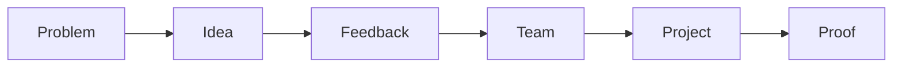

# Eduvos Incubation Hub

### Where campus problems become student ventures.

The Eduvos Incubation Hub app is a private platform for the Eduvos community. It brings problems, ideas, people and projects together. You can spot a problem, pitch an idea, get honest feedback, build a team with the right skills, run the project and earn recognition for it, all in one place.

---

## Why the hub needs it

- **Good ideas get lost.** They come up in corridors and group chats, then nobody follows them up.
- **Finding the right people is hard.** A student with a great idea often has no easy way to find classmates with the skills to build it.
- **The hub can't see who is building.** Real entrepreneurship on campus goes unnoticed and unrewarded.

The Incubation Hub app fixes all three.

---

## The journey

1. **Problem**: someone notices something that needs fixing.
2. **Idea**: someone proposes a solution and links it to the problem.
3. **Feedback**: the community questions it, challenges it and improves it.
4. **Team**: the founder brings in people whose skills are vouched for by their peers.
5. **Project**: the team plans the work and delivers it, one task at a time.
6. **Proof**: a hub administrator vouches for the entrepreneurship shown on the project.

---

## What you can do

### Spot problems
Post the real problems you see around you. Ideas can be linked to the problems they solve, so every solution starts from a real need.

### Share ideas, your way
Share an idea **publicly** with the whole campus. Or keep it **private** and share it only with the people you choose.

### Get real feedback
- Reddit-style threaded discussions under every idea.
- **Colour-coded comment types** (question, concern, suggestion and more) let you see the kind of feedback at a glance.
- **Hub administrators can add new comment types**, each with its own label and colour, so the feedback categories grow with the hub.
- Up and down votes bring the most useful input to the top.

### Show what you can do
Add skills to your profile from a shared campus skill list. Other users can **vouch** for your skills. Your profile shows how many people back each one, so your reputation comes from your peers, not from self-promotion.

### Build your circle
Mark people as **prospects**: potential collaborators you want to work with. Your private ideas can only be shared with your prospects, and removing someone from your prospects takes away their access to them straight away.

### Launch projects
- Start a project from an idea, or from scratch.
- Make it public, or keep it to the team.
- Other students can **request to join**, or you can **invite** your prospects.
- Create **custom roles** that fit your project, and give each team member the roles they need.

### Run the work
- Break the project into **tasks done in order**, each with an estimated deadline and a completed flag.
- Group work into **categories** such as design, development or marketing.
- Each role covers certain categories, so everyone can see which tasks belong to them.

### Show it off
Give your project a public page with a **video showcase** of what you've built.

### Earn recognition
When a project shows real entrepreneurship, a **hub administrator vouches for you** on that project, with a written note on what you did.

There are two kinds of vouch, and they are deliberately different:

| | Who can give it | What it says |
|---|---|---|
| **Skill vouch** | Any other user | "I can confirm this person has this skill." |
| **Entrepreneurship vouch** | **Hub administrators only** | "This person showed real entrepreneurship on this project." |

Nobody can vouch for themselves. Because every entrepreneurship vouch is tied to a real project and given by the hub, being an *Entrepreneur* on the platform means something.

---

## Who it's for

- **Students with ideas**: test your idea with the community, then build a team from people whose skills are vouched for.
- **Students with skills**: build a skill profile your peers back up, and join projects that need what you can do.
- **Hub staff and administrators**:
  - see the full pipeline, from problem to project;
  - recognise proven entrepreneurs;
  - spot the ventures worth backing;
  - shape how the community gives feedback by defining the comment types.

---

## Built for Eduvos

- **One sign-in.** You use your Eduvos Microsoft account, so everyone on the platform is a verified member of the Eduvos community.
- **Everywhere you are.** Use it in the browser or in the mobile app.
- **You stay in control.** Private ideas and projects are only seen by the people you choose.

---

> **Every venture starts as a problem someone noticed.**
> The Eduvos Incubation Hub gives those problems, and the people ready to solve them, somewhere to go.
